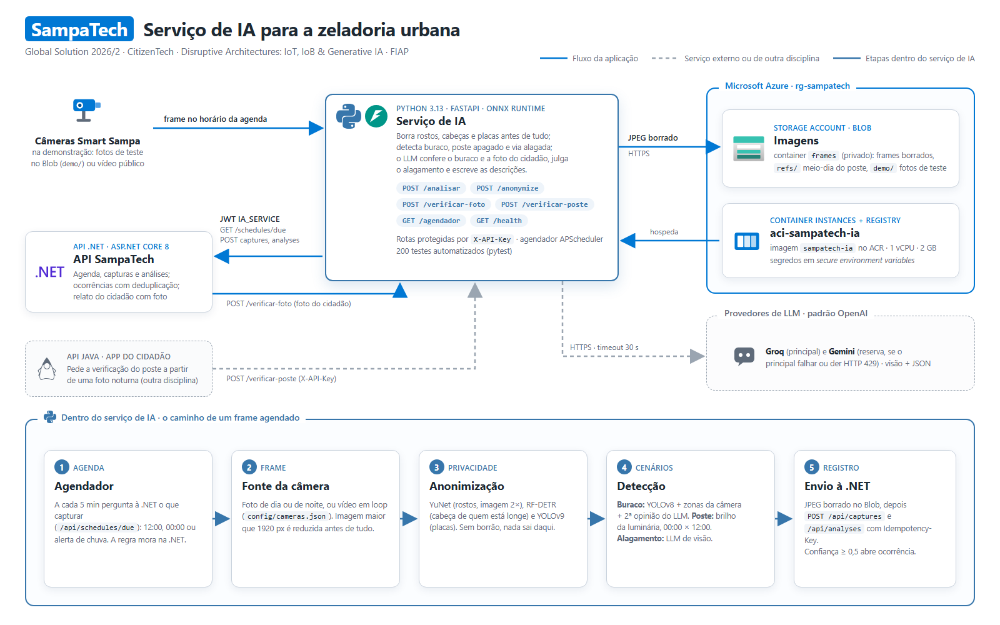
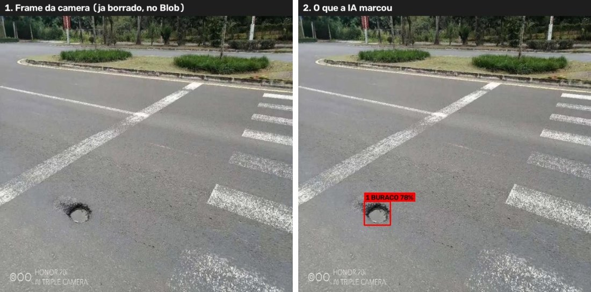

# SampaTech — Serviço de IA

Global Solution 2026/2 (FIAP) · tema **CitizenTech** · disciplina *Disruptive Architectures: IoT, IoB & Generative IA*.

## O problema e o público

São Paulo tem milhares de câmeras do **Smart Sampa** espalhadas pela cidade, mas buracos, postes apagados e
ruas alagadas ainda dependem de alguém ligar para o 156. O SampaTech reaproveita essas imagens para a
**zeladoria urbana**: em horários fixos (12:00 e 00:00) e durante alertas de chuva, o serviço de IA olha os
frames das câmeras, encontra o problema e registra na API .NET, que abre a **ocorrência** para a prefeitura.

| Público | O que ganha |
|---|---|
| **Prefeitura** (subprefeituras e equipes de manutenção) | Ocorrências abertas sozinhas, com tipo, severidade, posição na imagem e descrição técnica, sem duplicar o mesmo buraco a cada dia. |
| **Cidadão** | Acompanha as ocorrências no app com um texto simples, e pode conferir o conserto com uma foto (que esta IA borra antes de ser guardada). |

**Privacidade em primeiro lugar:** rostos, cabeças e placas são borrados **antes** de qualquer análise ou
gravação. Sem o borrão, nada sai do serviço. É o oposto de reconhecimento facial: a câmera olha para a rua, não
para as pessoas.

Este repositório é a parte de IA. A API .NET está em [`gs2-dotnet`](https://github.com/FIAP-2026-GS2/gs2-dotnet)
e a infraestrutura em `gs2-devops`.

## O que a IA faz

| Problema | Técnica | Quando roda | Por que essa técnica |
|---|---|---|---|
| **Buraco** | YOLOv8 pré-treinado (ONNX) + zonas ignoradas por câmera + **2ª opinião de um LLM de visão** | Frame das 12:00 | Sem dataset de São Paulo e com 4 dias de prazo, um modelo público avaliado num teste separado é mais confiável que um treino do zero. O LLM corta os falsos positivos (sombra, tampa de bueiro). |
| **Poste apagado** | Visão clássica: brilho e saturação na região de cada luminária, meia-noite comparada com o meio-dia | 12:00 (referência) e 00:00 | Uma regra simples e explicável resolve; comparar com o meio-dia da mesma câmera tira o efeito da posição e do tipo da lâmpada. |
| **Via alagada** | **LLM de visão** em zero-shot | Durante alerta de chuva | Não há dataset rotulado; o LLM entende contexto (água no meio-fio, roda submersa) e diferencia pista molhada de alagada. |
| **Foto do cidadão** | Borrão + **LLM de visão** responde 3 perguntas de sim ou não; a regra que aceita ou recusa fica no código | Quando o cidadão confirma ou contesta um conserto pelo app | Barra o que claramente não serve (selfie, pássaro, print de tela) antes de chegar à equipe, com um motivo que o cidadão entende. |
| **Descrições** | **LLM** gera o texto técnico (prefeitura) e o simples (cidadão), em JSON validado | Toda detecção | Linguagem natural é onde a IA generativa agrega mais. Sem LLM, o serviço usa textos-modelo (plano B). |
| **Privacidade** | YuNet (rostos), RF-DETR (cabeça de quem está longe), YOLOv9 (placas) | Antes de tudo | Modelos leves em ONNX, sem GPU. |

A **IA generativa** aparece em 5 usos: a 2ª opinião do buraco, o julgamento do alagamento, a verificação do
poste a partir de uma foto noturna (rota pedida pelo app), a conferência da foto do cidadão e as descrições.

## Arquitetura



O desenho é gerado a partir de [`docs/arquitetura.html`](docs/arquitetura.html), com os ícones do Azure, do
Python, do FastAPI e do .NET.

**O caminho de um frame agendado** (faixa de baixo do desenho):

1. **Agenda.** A cada 5 min, o agendador (APScheduler) pergunta à .NET o que capturar
   (`GET /api/schedules/due`). A regra (12:00, 00:00, alerta de chuva) mora no banco da .NET: a IA só executa.
   Se a IA cair e voltar em até 30 min, a .NET ainda devolve o frame, e nada é pedido duas vezes.
2. **Frame.** A imagem da câmera naquele instante. Sem acesso ao Smart Sampa, cada câmera aponta, no
   [`config/cameras.json`](config/cameras.json), para uma foto de dia e uma de noite (ou um vídeo em loop).
   Imagem com lado maior que 1920 px é reduzida.
3. **Privacidade.** Borrão de rostos, cabeças e placas.
4. **Cenários.** Os que a agenda pediu (buraco e poste às 12:00; poste às 00:00; alagamento na chuva).
5. **Registro.** O JPEG borrado vai ao Blob, e a .NET recebe a captura e a análise com `Idempotency-Key`.
   Com confiança ≥ 0,5, a .NET abre a ocorrência ou vincula a uma que já existe.

### Organização do código

| Pasta | Responsabilidade |
|---|---|
| `app/api/` | Rotas FastAPI (`/analisar`, `/anonymize`, `/verificar-foto`, `/verificar-poste`, `/agendador`), dependências e validação da entrada. |
| `app/vision/` | Visão computacional: leitura de imagem e vídeo, anonimização, detector de buraco, zonas e mosaico do verificador, regra do poste, desenho das caixas. |
| `app/llm/` | Cliente do LLM no padrão OpenAI (principal + reserva) e os prompts. |
| `app/analysis.py` | Orquestra os cenários de um frame e junta as detecções, com plano B sem LLM. |
| `app/integrations/` | Cliente da API .NET (login, renovação de token, 429 e 5xx com novas tentativas) e do Azure Blob. |
| `app/pipeline.py` | O caminho completo de um frame: borra, analisa, sobe ao Blob, cria captura e análise. |
| `app/scheduler.py` | O agendador: fonte de cada câmera e a rodada (um item com erro não para os outros). |
| `scripts/` | Avaliação, demonstração, download e conversão dos modelos, deploy no Azure. |
| `tests/` | 204 testes com pytest (sem internet, sem .NET e sem Blob: tudo com dublês). |

**Stack:** Python 3.13, FastAPI, Pydantic, ONNX Runtime (sem PyTorch em produção), OpenCV, APScheduler,
httpx, azure-storage-blob, pytest. Docker e Azure Container Instances.

## Rotas

Todas, menos `/health`, exigem o header `X-API-Key`. Documentação interativa em `/docs` (Swagger).

| Verbo | Rota | Quem chama | O que faz |
|---|---|---|---|
| `GET` | `/health` | .NET e Azure | Diz se o processo está de pé e quais integrações estão configuradas (sem segredos). |
| `POST` | `/analisar` | demonstração e testes | Recebe uma foto, borra e roda os cenários pedidos (`analises`, `periodo`, `camera`). Responde JSON com as detecções ou a imagem marcada (`formato=imagem`). |
| `POST` | `/anonymize` | auxiliar | Só borra: devolve o JPEG borrado e, nos headers, quantos rostos, placas e pessoas foram borrados. A .NET usava esta rota antes do `/verificar-foto`, que já borra; ela continua disponível. |
| `POST` | `/verificar-foto` | API .NET (v1.3.0) | Borra a foto do cidadão e pergunta ao LLM se ela serve como prova do conserto (ou da falta dele). Devolve o veredito, o motivo para o cidadão e a foto borrada em base64. |
| `POST` | `/verificar-poste` | API Java (app) | Diz se a luminária da foto noturna está acesa, apagada ou indeterminada (LLM; regra de brilho como plano B). |
| `GET` | `/agendador` | operação | Se o agendador está ligado e o resultado da última rodada. |

**Erros:** 401 (sem chave), 413 (arquivo > 10 MB), 415 (não é imagem), 400/422 (imagem inválida ou parâmetro
errado), 503 (anonimizador indisponível: por privacidade, nenhuma imagem é processada sem borrão).

### Foto do cidadão: `/anonymize` e `/verificar-foto`

Depois que a prefeitura marca uma ocorrência como resolvida, o cidadão pode mandar pelo app uma foto
**confirmando** o conserto ou **contestando** ("o buraco continua lá"). A foto vai presa à ocorrência, então a
localização do problema já é conhecida; o app manda junto a latitude e a longitude do celular.

A .NET chama o **`/verificar-foto`**: ele borra e confere numa chamada só. O `/anonymize` ficou como rota
auxiliar, para quem só precisa do borrão.

- **`POST /anonymize`** (`file`): devolve o JPEG borrado e, nos headers `X-Faces-Blurred`, `X-Plates-Blurred`,
  `X-Persons-Blurred` e `X-Faces-Unconfirmed`, quantas áreas foram borradas. Foto acima de 1920 px volta
  reduzida. O JPEG novo não leva os metadados EXIF da foto original (como o GPS embutido).
- **`POST /verificar-foto`** (`file`, `categoria` = `BURACO` | `FAIXA_APAGADA` | `POSTE_APAGADO` |
  `VIA_ALAGADA`, `decisao` = `CONFIRM` | `CONTEST`): borra, manda **só a foto borrada** ao LLM e aplica a regra.

O LLM só responde três perguntas de sim ou não. **Quem decide é a regra, no código**, igual para todo mundo e
coberta por testes:

| Decisão do cidadão | A foto é aceita quando… |
|---|---|
| `CONTEST` (continua com problema) | é uma via pública **e** mostra o problema |
| `CONFIRM` (foi consertado) | é uma via pública **e** mostra o lugar do tipo certo (ex.: pista ou calçada, para buraco) |

```json
{
  "valida": false,
  "motivo": "A foto não mostra buraco no asfalto: Rua com calçada de paralelepípedos e asfalto liso, sem buracos visíveis.",
  "descricao": "Rua com calçada de paralelepípedos e asfalto liso, sem buracos visíveis",
  "confianca": 0.95,
  "via_publica": true, "local_do_tipo": true, "mostra_o_problema": false,
  "rostos_borrados": 0, "placas_borradas": 0, "pessoas_borradas": 12,
  "llm": { "provedor": "principal", "modelo": "qwen/qwen3.8-27b", "latencia_ms": 2597 },
  "foto_borrada_base64": "/9j/4AAQSkZJRgABAQAAAQAB..."
}
```

**O que a .NET faz com a resposta:** lê só `valida`, `motivo` e `foto_borrada_base64`. Com `valida: false`,
responde 422 ao app com o motivo e não grava nada; com qualquer erro da IA, responde 503 e também não grava. Com
`valida: true`, guarda no Blob **a foto que a IA devolveu** (a original nunca é salva) e o relato entra na fila
de revisão da equipe. A .NET espera até 60 s pela IA.

O prompt pede ao LLM que, **na dúvida razoável, responda sim**: toda foto aceita ainda é revisada por uma pessoa
da equipe na .NET; a IA só barra o que claramente não serve. Sem borrão ou sem LLM, a rota responde 503 e
nada é conferido.

### Exemplo: o que a IA manda à .NET para um buraco

```json
{
  "issueTypeId": 1,
  "confidenceScore": 0.776,
  "estimatedSeverity": "LOW",
  "detectionCoordinates": "144,441,57,52",
  "description": "Buraco no pavimento localizado próximo à faixa de pedestres e à linha de divisão de pista. | Para o cidadão: Há um buraco na pista, perto da faixa de pedestres, que precisa de reparo no asfalto."
}
```

A severidade sai do tamanho do buraco na imagem (< 3% LOW, < 6% MEDIUM, < 9% HIGH, acima CRITICAL). O texto
para o cidadão vai junto porque a rota pública da .NET mostra esse campo no app.

## Dados

| Dado | Origem | Licença | Uso |
|---|---|---|---|
| Modelo de buraco (escolhido) | [Samdutse/pothole-yolov8](https://huggingface.co/Samdutse/pothole-yolov8), convertido de `.pt` para ONNX no build | não declarada no card | Detecção |
| Modelo de buraco (descartado) | [vinothvikas1987/pothole-detection-yolov8](https://huggingface.co/vinothvikas1987/pothole-detection-yolov8) | Apache 2.0 | Comparação |
| Teste do buraco | 100 fotos com buraco do dataset *Potholes Detection* (Roboflow) + 6 fotos de rua sem buraco | CC BY 4.0 | Avaliação |
| Rostos | YuNet (OpenCV Zoo) | MIT | Borrão |
| Placas | YOLOv9-tiny (open-image-models) | MIT | Borrão |
| Pessoas | RF-DETR nano COCO (open-image-models) | Apache 2.0 | Borrão da cabeça |
| Câmeras de teste | Prints de câmeras públicas da CET | uso só em teste | Ensaios; **não** ficam no repositório |

**Preparação:**
- Os modelos não ficam no Git: `scripts/baixar_modelos.py` baixa e confere o **SHA-256** de cada um, e o
  Dockerfile converte o modelo de buraco num estágio separado (o PyTorch não vai para a imagem final).
  Detalhes e hashes em [`models/README.md`](models/README.md).
- As fotos de teste ficam no **Blob privado**, já borradas, enviadas por `scripts/subir_fontes_demo.py` a
  partir da lista [`config/fontes_demo.json`](config/fontes_demo.json). O código não supõe nome de arquivo.
- Cada câmera tem, no `config/cameras.json`, a posição das luminárias e as zonas que parecem buraco mas não
  são (tampa metálica, grelha), marcadas à mão num frame de referência.

## Avaliação e testes

### Buraco: escolha do modelo

`python -m scripts.avaliar_buraco` (IoU ≥ 0,5, limiar 0,25), no teste separado de 100 fotos:

| Modelo | Precisão | Recall | F1 |
|---|---|---|---|
| A · RDD (Japão/Índia, 5 classes) | 42,9% | 1,1% | 2,2% |
| **B · Smartathon (Arábia Saudita)** | **82,0%** | **74,3%** | **78,0%** |

O A chama quase todo buraco desse conjunto de "Other". Escolhemos o B.

### Buraco: com a 2ª opinião do LLM

Em câmera de rua, o B confundia sombra de poste, tampa de bueiro e faixa pintada com buraco. Cada caixa passa
agora por um LLM de visão (um mosaico com todos os recortes do frame, numa chamada só):

| Versão do verificador | Precisão | Recall | F1 | Fotos sem buraco com alarme |
|---|---|---|---|---|
| 1ª (rígida: poça e remendo nunca eram buraco) | 87,7% | 39,8% | 54,7% | 0 de 6 |
| **2ª (buraco com água e remendo afundado contam)** | **85,7%** | **60,2%** | **70,7%** | **0 de 6** |

**Interpretação:** trocamos parte do recall por menos ocorrência falsa. Uma ocorrência errada manda uma equipe
à toa; um buraco perdido hoje volta a aparecer no frame de amanhã. Parte do recall perdido vem do plano
gratuito do LLM: 25 caixas ficaram sem resposta (HTTP 429) e, sem 2ª opinião, a caixa fica abaixo de 0,5 e não
abre ocorrência.

### Poste e alagamento

- **Poste:** as 9 lâmpadas acesas das fotos de teste foram classificadas como acesas. Numa foto real com uma
  lâmpada escurecida (simulação), a IA acusou `POSTE_APAGADO` com 95% e manteve a outra como acesa.
- **Alagamento:** numa câmera com pista molhada e reflexos, o LLM respondeu "molhada, não alagada", o resultado
  certo. A avaliação é qualitativa: não há dataset de alagamento rotulado.

### Foto do cidadão (`/verificar-foto`, LLM real)

| Foto enviada | Decisão | Resultado |
|---|---|---|
| Buraco real (celular) | `CONTEST` | ✅ válida: "buraco no asfalto com exposição do material de base e rachaduras ao redor" |
| Rua sem buraco | `CONFIRM` | ✅ válida: "asfalto liso, sem buracos visíveis" |
| Rua sem buraco | `CONTEST` | ❌ "A foto não mostra buraco no asfalto: calçada pavimentada e rua asfaltada sem buracos visíveis." |
| Retrato de pessoa | `CONFIRM` | ❌ "A foto não mostra uma via pública: …" (os 2 rostos foram borrados antes do LLM) |

No ensaio de ponta a ponta **pela .NET** (token real de um cidadão de teste emitido pela API Java), as fotos
aceitas viraram relato na fila da equipe (201), e as recusadas voltaram ao app com o motivo, sem gravar nada:
um print de tela ("A foto não mostra uma via pública: diagrama de arquitetura de software com caixas e
setas."), uma pintura de um rosto, uma multidão de perto e a rua sem buraco usada para contestar.

### Privacidade

- Rostos reais nas fotos de teste tiveram nota 0,88 a 0,93; os "rostos" falsos das câmeras (desenho na faixa,
  asfalto à noite), 0,69 a 0,79. Rosto com nota média só é borrado se o detector de pessoas também viu alguém
  ali: os 5 rostos reais continuam borrados e os 4 falsos saíram.
- Foto de celular (4000 × 3000) levava até 25 s para borrar. Reduzida para 1920 px, de 3 a 6 s, achando os
  mesmos buracos e placas (teste com 4 fotos reais do Wikimedia Commons).

### Demonstração de ponta a ponta (API .NET na nuvem)

Câmera de demonstração `DEMO-BURACO`, com uma foto do dataset público, cadastrada na .NET com agenda às 12:00:



<sub>Foto: dataset *Potholes Detection* (Roboflow), CC BY 4.0.</sub>

- **Dia 21, 12:00:** a .NET abriu a ocorrência 1, "Buraco no asfalto - Avenida de Demonstração", com status
  `OPEN`, severidade `LOW`, origem `AI_DETECTION` e, na rota pública, o texto da IA para o cidadão.
- **Dia 22, 12:00:** o mesmo buraco foi **vinculado** à ocorrência 1, sem abrir outra:

```
$ python -m scripts.rodar_agendador --at 2026-11-22T12:00-03:00
Fontes de frame configuradas: CET-BRASIL, CET-CIDADE-JARDIM, CET-CONSOLACAO, CET-IGUATEMI, CET-IBIRAPUERA, DEMO-BURACO
  - CET-CONSOLACAO · 2026-11-22T15:00:00+00:00 · FIXED_TIME → SENT · imagem 6 · 0 detecção(ões)
LLM reserva respondeu depois de falha(s): principal: HTTP 429
  - DEMO-BURACO · 2026-11-22T15:00:00+00:00 · FIXED_TIME → SENT · imagem 7 · 1 detecção(ões)
      tipo 1 · confiança 0.776 · LINKED_TO_EXISTING_ISSUE · ocorrência 1
  2 frame(s) na agenda; 2 enviado(s)
```

O LLM principal bateu no limite de uso e o reserva assumiu, sem mudar o resultado.
O mesmo ensaio rodou num **clone limpo** dentro do Docker: a foto veio do Blob e o modelo, do build.

### Situações de falha

| Situação | O que acontece | Onde é testado |
|---|---|---|
| Arquivo que não é imagem, vazio ou acima de 10 MB | 400/422, 413 ou 415, nada é processado | `test_analyze`, `test_anonymize`, `test_photo_check` |
| Modelo de borrão ausente ou com erro | 503 e nenhuma imagem sai do serviço; o agendador não envia o frame | `test_anonymizer`, `test_integrations` |
| Modelo de buraco ausente | a API sobe; a resposta avisa "modelo indisponível" e os outros cenários seguem | `test_scenarios` |
| LLM principal fora ou com limite (429) | o reserva assume; se os dois falharem: buraco fica em 0,49 (não abre ocorrência), poste usa a regra de brilho, `/verificar-foto` responde 503 | `test_llm_client`, `test_scenarios`, `test_streetlight`, `test_photo_check` |
| LLM responde fora do formato | conta como falha (mesmo caminho acima), nunca vira detecção | `test_llm_client`, `test_photo_check` |
| .NET fora do ar, 401, 429 ou 5xx | renova o token, espera o `Retry-After`, tenta de novo com a mesma `Idempotency-Key` | `test_integrations` |
| Reenvio do mesmo horário | a .NET não pede de novo; a chave de idempotência evita duplicar | `test_integrations`, ensaio na nuvem |
| Foto escura (meia-noite) | buraco não roda à noite; poste compara com o meio-dia | `test_scenarios` |
| Foto de celular muito grande | reduzida para 1920 px antes do borrão | `test_frames`, `test_anonymize` |

### Testes automatizados

```bash
pip install -r requirements-dev.txt
pytest
```

**204 testes**, sem rede: rotas (chave, formatos, erros), anonimização (borrão, falha segura, confirmação dupla
do rosto), buraco (letterbox, NMS, zonas, verificador), poste, cliente do LLM (reserva, JSON inválido), cliente
da .NET (login, 401, 429 com `Retry-After`, 5xx), Blob, pipeline, agendador, a regra do `/verificar-foto` e configuração.

## Como rodar

**Pré-requisitos:** Python 3.13, Git e, para o modelo de buraco, Docker.

1. Clonar e instalar:
   ```bash
   git clone https://github.com/FIAP-2026-GS2/gs2-ia-iot.git
   cd gs2-ia-iot
   python -m venv .venv
   .venv/Scripts/python.exe -m pip install -r requirements-dev.txt   # no Linux/Mac: .venv/bin/python
   ```
2. Configurar: copiar `.env.example` para `.env` e preencher. A única obrigatória é a `IA_API_KEY`; o resto
   liga as integrações (.NET, Blob, LLM). Variável vazia = integração desligada.
3. Baixar os modelos de privacidade (confere o SHA-256):
   ```bash
   .venv/Scripts/python.exe -m scripts.baixar_modelos
   ```
4. Subir a API e abrir `http://localhost:8000/docs`:
   ```bash
   .venv/Scripts/python.exe -m uvicorn app.main:app --reload --port 8000
   ```

**Modelo de buraco:** o autor publica só o `.pt` do PyTorch. Para ter o buraco, use o Docker, que converte no
build:

```bash
docker build -t sampatech-ia .
docker run --rm -p 8000:8000 --env-file .env sampatech-ia
```

Sem o modelo, a API sobe do mesmo jeito e a resposta avisa "Buraco: modelo indisponível".

### Demonstração com a .NET

Com a .NET, o Blob e os `ISSUE_TYPE_ID_*` no `.env`:

```bash
python -m scripts.testar_dotnet --at 2026-11-21T12:00-03:00     # login e agenda (só leitura)
python -m scripts.rodar_agendador --at 2026-11-21T12:00-03:00   # uma rodada do agendador, frame a frame
python -m scripts.subir_fontes_demo                              # sobe as fotos de teste, borradas, ao Blob
```

O `--at` simula outro horário: a .NET responde como se fossem 12:00, sem esperar o meio-dia.

**Aquecimento:** na subida, a API roda o borrão e o detector de buraco uma vez numa imagem preta
(`app/warmup.py`), porque a 1ª execução de um modelo ONNX é a mais lenta. Assim a primeira foto real já sai
rápida (medido na nuvem: 3,9 s na 1ª chamada do `/anonymize`, 2,9 s na 2ª). Quando o LLM principal bate no limite de uso (429), o
reserva assume e a resposta pode chegar a ~40 s.

### Deploy no Azure

`bash scripts/deploy_aci.sh` constrói a imagem, envia ao Azure Container Registry e recria o container
`aci-sampatech-ia` no mesmo Resource Group da API, com as variáveis do `.env.cloud` (segredos em *secure
environment variables*) e espera o `/health` responder.

## Segurança e uso responsável

- **Nenhum segredo no repositório:** `.env` e `.env.cloud` estão no `.gitignore`; segredos com valor de exemplo
  são recusados na subida, e o erro de configuração nunca mostra o valor recebido.
- **Imagem sem borrão não sai do serviço:** se a anonimização falhar, a rota responde 503 e o agendador não
  envia o frame. O JPEG gerado também não leva os metadados EXIF da foto original (como o GPS do celular).
- **Blob privado:** a URL que a .NET guarda não abre sem credencial.
- **A IA sugere, a prefeitura decide:** abaixo de 0,5 a detecção só é registrada; buraco sem 2ª opinião do LLM
  fica em 0,49 e não abre ocorrência; a foto do cidadão que a IA aceita ainda passa por revisão da equipe na
  .NET, e a recusada volta com um motivo em linguagem simples.
- **Limite de uso dos provedores:** o LLM só é chamado quando há detecção ou alerta, com reserva e tempo limite.

## Limitações e melhorias futuras

**Limitações conhecidas:**
- Sem acesso ao Smart Sampa: a demonstração usa fotos de teste no lugar do stream das câmeras.
- O modelo de buraco foi treinado com fotos de dia e de outro país; por isso só roda no frame do meio-dia.
- No plano gratuito do LLM, parte das chamadas volta com limite de uso (429); sem 2ª opinião, o buraco não vira
  ocorrência.
- Pedestres muito pequenos (cabeça com menos de ~12 px) não são detectados para borrar; nesse tamanho também
  não são identificáveis.
- **Faixa de pedestre apagada:** o modelo próprio não foi entregue por falta de fotos rotuladas de São Paulo.
  O guia de coleta está em [`docs/guia-fotos-faixa.md`](docs/guia-fotos-faixa.md).

**Melhorias futuras:**
1. **Persistência temporal:** só abrir ocorrência de buraco quando a mesma caixa aparecer em N dias seguidos,
   cortando o falso positivo que aparece uma vez só (sombra num horário específico).
2. **Ajuste fino com fotos de São Paulo:** treinar o YOLO com frames das câmeras da cidade, de dia e de noite,
   começando pelos casos que o verificador recusou.
3. Modelo da faixa apagada com o guia de coleta acima.
4. Ler o stream real das câmeras no lugar das fotos de teste.
5. Publicar o modelo de buraco já convertido, com SHA-256 fixo, para o build não precisar do PyTorch.

## Uso de IA generativa no desenvolvimento

**Ferramenta:** Claude Code (Anthropic).

**Para que foi usada:**
- **Implementação assistida:** o código foi escrito com apoio da IA, em passos pequenos. Antes de cada passo, as
  alternativas técnicas (com prós e contras) foram apresentadas, e a escolha foi do autor (por exemplo: modelo
  pré-treinado no buraco, 2ª opinião do LLM, fotos de teste no Blob, limite de 1920 px).
- **Avaliação:** scripts de avaliação e comparação, rodados e interpretados pelo autor.
- **Explicação de conceitos e erros:** idempotência, letterbox e NMS do YOLO, rate limit dos provedores.

**Como garantimos entendimento e revisão:**
- Cada etapa foi testada manualmente (Swagger e terminal) antes do commit, inclusive o ensaio de ponta a ponta
  com a .NET na nuvem e o clone limpo.
- Todo o código foi revisado e commitado pelo autor, em branches por funcionalidade.
- 204 testes automatizados.

## Integrantes

| Nome | RM | Turma |
|---|---|---|
| Ana Carolina Pereira Fontes | RM562145 | 2TDSPV |
| João Victor Nascimento Adão | RM563409 | 2TDSPX |
| Johnny Dias Mathias Junior | RM566516 | 2TDSPX |
| Luisa Ganasevici de Abreu | RM563403 | 2TDSPV |
| Matheus Moya de Oliveira | RM562822 | 2TDSPV |
